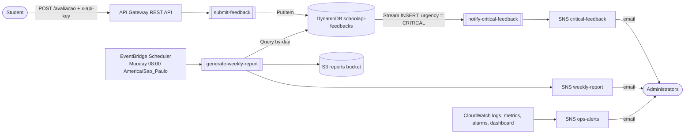

# SchoolAPI — Serverless Course Feedback on AWS

- [🇨🇦 English Description](#english-description)

- [🇧🇷 Descrição em Português](#descrição-em-português)

---

## 🇨🇦English Description

Serverless platform built for the **Tech Challenge — Phase 04** of the FIAP postgraduate program (Pós Tech,
Arquitetura e Desenvolvimento Java). Students rate classes through `POST /avaliacao`, administrators are emailed
automatically about critical feedback, and a weekly report with the average score is generated on a schedule.

## Demo video

[▶️ Watch on YouTube](https://youtu.be/W5ldOkT-TtU)

## Cloud model

- **Provider and deployment model:** public cloud, AWS, one region (`us-east-1`). Everything is defined as code in
  `infra/template.yaml` (AWS SAM, on top of CloudFormation).
- **Service model: serverless.** The business logic runs as **FaaS** (AWS Lambda, Java 21), and everything around it is a
  fully managed service: API Gateway, DynamoDB, SNS, S3, EventBridge Scheduler, CloudWatch and KMS. There are no servers,
  containers or operating systems to manage.
- **Why serverless:** the load is small and bursty (students submit after class, one report per week), so pay-per-request
  and scale-to-zero cost almost nothing while idle and scale automatically under load. Each function has one
  responsibility, its own trigger, role and log group, so it can change and be deployed independently.
- **Shared responsibility:** AWS secures and operates the infrastructure (hardware, runtime, patching, availability);
  this project is responsible for its code, data, encryption settings, IAM permissions and access governance (see
  [Security and access governance](#security-and-access-governance)).
- **Cost:** on-demand everywhere (DynamoDB on-demand, Lambda per request, no provisioned capacity). At demo volumes it
  stays within the AWS free tier except for the KMS key (about US$1/month).

## Architecture


**Components**

| Component | AWS service | Role |
|---|---|---|
| Entry point | API Gateway REST API (`schoolapi-api`, stage `prod`) | `POST /avaliacao`; API key + usage plan; JSON-schema validation before Lambda runs |
| `submit-feedback` | Lambda | Validates, classifies urgency, stores the feedback |
| Feedback store | DynamoDB `schoolapi-feedbacks` | On-demand, KMS-encrypted, PITR, stream `NEW_IMAGE`, GSI `by-day` |
| Critical trigger | DynamoDB Streams + Lambda event filter | Invokes the notifier only for `INSERT` with `urgency = CRITICAL` |
| `notify-critical-feedback` | Lambda + SQS DLQ | Emails the admins; failed records retried 3 times, then sent to the DLQ |
| Schedule | EventBridge Scheduler | Every Monday at 08:00 `America/Sao_Paulo` |
| `generate-weekly-report` | Lambda | Aggregates the last 7 days, stores the report, emails the summary |
| Report store | S3 `schoolapi-reports-<account>` | Private, KMS-encrypted, versioned, `reports/YYYY/Www.json` |
| Notifications | SNS `critical-feedback`, `weekly-report`, `ops-alerts` | Email subscriptions for the admins |
| Observability | CloudWatch Logs, Metrics, Alarms, Dashboard | See [Monitoring](#monitoring) |
| Encryption | KMS key `alias/schoolapi` | Table, logs, topics and bucket |

**Data model.** Table `schoolapi-feedbacks`, one item per feedback; the `by-day` index lets the report read one day at a
time instead of scanning the table.

| Attribute | Type | Key | Example |
|---|---|---|---|
| `id` | String (UUID) | partition key | `5b526bcc-ca95-427a-a898-4c687819ea9b` |
| `description` | String (1–1000 chars) | | `A aula ficou confusa e os exemplos não funcionaram.` |
| `score` | Number (0–10) | | `2` |
| `urgency` | String | | `CRITICAL` |
| `submittedAt` | String (UTC ISO-8601) | `by-day` sort key | `2026-11-19T06:41:39.702Z` |
| `day` | String (`yyyy-MM-dd`, São Paulo date) | `by-day` partition key | `2026-11-19` |

Urgency rule (an assumption, since the brief doesn't define one): `0–3 → CRITICAL`, `4–6 → MEDIUM`, `7–10 → LOW`. Timestamps are stored in UTC; dates in emails and
reports are shown in `America/Sao_Paulo`.

**Code layout (Clean Architecture).** `shared/` holds the entities (`Feedback`, `Urgency`, `ReportPeriod`,
`WeeklyReport`), the use cases (`SubmitFeedback`, `NotifyCriticalFeedback`, `GenerateWeeklyReport`) and the gateway
interfaces; it has no AWS code except the shared DynamoDB gateway. Each `functions/<name>/` module only has the Lambda
handler (event in, one use case, response out) and its AWS gateway implementations.

## Serverless functions

| | `submit-feedback` | `notify-critical-feedback` | `generate-weekly-report` |
|---|---|---|---|
| **Single responsibility** | Validate, classify and store one feedback | Send the urgent notice for one critical feedback | Aggregate a week, store the report, send the summary |
| **Trigger** | API Gateway `POST /avaliacao` | DynamoDB stream, filtered to `INSERT` + `urgency = CRITICAL` | EventBridge Scheduler (weekly) or manual invoke |
| **Input** | `{"descricao", "nota"}` | Stream record (`NewImage`) | `{}` or `{"referenceDate": "yyyy-MM-dd"}` |
| **Output** | `201` / `400` / `500` (see [Endpoint](#endpoint)) | Email via SNS `critical-feedback`; partial batch failures | `reports/YYYY/Www.json` in S3 + email via SNS `weekly-report` |
| **Permissions** | `dynamodb:PutItem` on the table; KMS via DynamoDB | `sns:Publish` on its topic; stream read; DLQ send; KMS via DynamoDB/SNS | `dynamodb:Query` on `by-day`; `s3:PutObject` on `reports/*`; `sns:Publish` on its topic; KMS via DynamoDB/S3/SNS |
| **Metric** | `FeedbackReceived` (by `urgency`) | `NotificationSent` | `ReportGenerated` |
| **Handler** | `SubmitFeedbackHandler` | `NotifyCriticalFeedbackHandler` | `GenerateWeeklyReportHandler` |

All three: Java 21 on arm64, 512 MB, Powertools JSON logs, own KMS-encrypted log group (14 days).

Critical-feedback email (pt-BR, as the admins receive it):

```text
[Urgente] Novo feedback crítico recebido

Um novo feedback crítico foi recebido.

Descrição: A aula ficou confusa e os exemplos não funcionaram.
Urgência: Crítica
Data de envio: 19/11/2026 03:41
```

The weekly email (`Relatório semanal de feedbacks — 2026-W46`) has the period, `Média das avaliações`, the total,
`Avaliações por dia`, `Avaliações por urgência` and every feedback with `Descrição`, `Urgência` and `Data de envio`. The
same data is stored as JSON in S3. To generate a report now (for example, for last week):

```bash
scripts/invoke-report.sh
scripts/invoke-report.sh 2026-11-16
```

## Endpoint

`POST /avaliacao` (header `x-api-key` required). The URL and key id are stack outputs (`ApiUrl`, `ApiKeyId`).

Request:

```json
{ "descricao": "A aula ficou confusa e os exemplos não funcionaram.", "nota": 2 }
```

| Status | When | Body |
|---|---|---|
| `201` | Stored | `{"id", "urgency", "submittedAt"}` |
| `400` | `descricao` missing/blank/over 1000 chars, `nota` missing or outside 0–10, extra fields, malformed JSON | `application/problem+json` with `errors` (rejected by the gateway: `{"errors": [...]}`; by the function: also `title` and `status`) |
| `403` | Missing or wrong API key | API Gateway default |
| `429` | Over 10 req/s (burst 20) or 5000/day | API Gateway default |
| `500` | Unexpected error (no details leaked) | `{"title": "Internal server error", "status": 500}` |

`201` example:

```json
{ "id": "5b526bcc-ca95-427a-a898-4c687819ea9b", "urgency": "CRITICAL", "submittedAt": "2026-11-19T06:41:39.702Z" }
```

`400` example (`"nota": 11`):

```json
{ "errors": ["[numeric instance is greater than the required maximum (maximum: 10, found: 11)]"] }
```

Try it (or run `scripts/smoke-test.sh`):

```bash
API_URL=$(aws cloudformation describe-stacks --stack-name schoolapi --query "Stacks[0].Outputs[?OutputKey=='ApiUrl'].OutputValue" --output text)
API_KEY=$(aws apigateway get-api-key --include-value --query value --output text --api-key $(aws cloudformation describe-stacks --stack-name schoolapi --query "Stacks[0].Outputs[?OutputKey=='ApiKeyId'].OutputValue" --output text))
curl -i -X POST "$API_URL" -H "Content-Type: application/json" -H "x-api-key: $API_KEY" -d '{"descricao":"A aula ficou confusa e os exemplos não funcionaram.","nota":2}'
```

## Security and access governance

Covers the requirement *"segurança relacionada aos dados de clientes e governança de acesso"*. Every control is in
`infra/template.yaml` (app stack) or `infra/bootstrap/access-governance.yaml` (access stack), except the ones marked
**console**.

**Customer data protection**

| Control | Where | Requirement it meets |
|---|---|---|
| Customer-managed KMS key `alias/schoolapi`, yearly rotation | `FeedbackKey` | Encryption at rest under our own key |
| Feedbacks table, logs, both SNS topics and the reports bucket encrypted with that key | `FeedbacksTable`, `*LogGroup`, `*Topic`, `ReportsBucket` | Student data encrypted at rest everywhere it is stored |
| TLS only: requests without HTTPS are denied | `ReportsBucketPolicy`, `*TopicTlsOnlyPolicy`, `AuditTrailBucketPolicy` | Encryption in transit |
| Point-in-time recovery (35 days) | `FeedbacksTable` | Data can be restored after a mistake |
| Private reports bucket: Block Public Access, owner-enforced, versioned | `ReportsBucket` | Reports never public |
| API key + usage plan (10 rps, burst 20, 5000/day) + JSON-schema validation at the gateway | `FeedbackApi` | Limits abuse; bad input never reaches the function |
| Least-privilege role per function: `PutItem` only (submit), `Query` on the `by-day` index only (report), `Publish` on its own topic, KMS use only through DynamoDB/SNS/S3 (`kms:ViaService`) | function `Policies` | Each function can only do its one job |
| Student text never logged (only id, score, urgency); access logs have no body | handlers, `AccessLogSetting` | Customer data stays out of logs |
| Logs kept 14 days | `*LogGroup` | Data minimization |

**Access governance**

| Control | Where | Requirement it meets |
|---|---|---|
| `FeedbackAdmins`: deploy and operate the stack, read data | access stack (Identity Center) | Separation of duties |
| `FeedbackDevelopers`: stack config, function config, logs and metrics; no data, no deploy (deploys go through CI) | access stack (Identity Center) | Separation of duties |
| `FeedbackReadOnly`: metrics, alarms, dashboards and stack status only | access stack (Identity Center) | Separation of duties |
| MFA required at every sign-in (Identity Center → Settings → Authentication) | **console** | Strong authentication |
| No root access keys, root MFA on; people sign in through Identity Center only | **console** | Strong authentication |
| CloudTrail trail `schoolapi-audit`: management events, all regions, log file validation, retained private bucket | `AuditTrail`, `AuditTrailBucket` | Audit of who did what |
| Tags `Project`, `Owner`, `Env` on every resource | `infra/samconfig.toml` (stack tags) | Ownership and cost tracking |

Deploy the access stack once, as an administrator:

```bash
aws sso-admin list-instances --query 'Instances[0].[InstanceArn,IdentityStoreId]' --output text
aws cloudformation deploy --template-file infra/bootstrap/access-governance.yaml --stack-name schoolapi-access-governance --parameter-overrides InstanceArn=<instance-arn> IdentityStoreId=<identity-store-id> --tags Project=schoolapi Owner=vitorbetmann Env=prod
```

Then add people to the groups (console, or `aws identitystore create-group-membership`).

> SAM attaches the AWS-managed `AWSLambdaBasicExecutionRole` (and `AWSLambdaDynamoDBExecutionRole` for the stream
> trigger), whose resources are `*`; every statement written in the template is resource-scoped. In AWS Academy
> Learner Lab, IAM roles, Identity Center and CloudTrail can't be created: with `LambdaRoleArn` set, every function
> uses `LabRole` and the trail is skipped. The generated roles above are the intended production setup.

## Monitoring

Covers the requirement *"aplicação monitorada"*. Everything is in `infra/template.yaml`.

| What | How |
|---|---|
| Structured logs | Powertools JSON logs per function (request id, cold start, API correlation id), KMS-encrypted, 14 days |
| API access logs | JSON access log per request in `/aws/apigateway/schoolapi-access` |
| Business metrics | Powertools Metrics (EMF), namespace `SchoolAPI`: `FeedbackReceived` (by `urgency`), `NotificationSent`, `ReportGenerated` |
| Alarms → email | `schoolapi-ops-alerts` SNS topic (KMS-encrypted, TLS-only); one alarm per function on `Errors > 0`, API `5XXError > 0`, DLQ messages `> 0`. Each alarm also emails when it goes back to OK |
| Dashboard | `schoolapi-operations`: invocations, errors and duration per function, API requests/4XX/5XX, feedbacks by urgency, notices sent, reports generated, DLQ depth, alarm status |

Open the dashboard with the `DashboardUrl` stack output. To see an alarm fire, make the report function fail on purpose:

```bash
aws lambda invoke --function-name schoolapi-generate-weekly-report --cli-binary-format raw-in-base64-out --payload '{"referenceDate":"invalid"}' /dev/null
```

Within about 5 minutes `schoolapi-generate-weekly-report-errors` goes to ALARM and the admin gets an email; it returns to OK (another email) after the next quiet period.

## Deploy (manual and automated)

Requirements: AWS account, AWS CLI v2, SAM CLI, JDK 21, Maven 3.9+. Maven builds the function JARs and SAM only
packages and deploys them.

**Manual (first deploy).** Use credentials with administrator rights in the target account (for example `aws configure sso`, then `export AWS_PROFILE=<profile>`). `AdminEmail` is needed only the first time; later deploys reuse it. Confirm the three SNS
subscription emails (critical feedback, weekly report, ops alerts) after the first deploy.

```bash
git clone https://github.com/vitorbetmann/schoolapi.git
cd schoolapi
mvn -q verify
sam build --config-file infra/samconfig.toml
sam deploy --config-file infra/samconfig.toml --no-confirm-changeset --parameter-overrides Stage=prod AdminEmail=<admin-email>
scripts/smoke-test.sh
```

**Automated (every push to `main`).** `.github/workflows/deploy.yml` runs `mvn -B verify` → `sam build` → `sam deploy`.
AWS credentials come from GitHub OIDC (no stored keys), and the job runs in the protected `prod` environment, which only
accepts `main` and waits for a reviewer's approval. The workflow role can only manage the `schoolapi` stack's change sets;
CloudFormation applies them with its own execution role. One-time setup, as an administrator:

```bash
gh api repos/<owner>/<repo> --jq '.owner.id, .id'
aws cloudformation deploy --template-file infra/bootstrap/github-oidc.yaml --stack-name schoolapi-github-oidc --capabilities CAPABILITY_NAMED_IAM --parameter-overrides GitHubOwner=<owner> GitHubOwnerId=<owner-id> GitHubRepo=<repo> GitHubRepoId=<repo-id> --tags Project=schoolapi Owner=<owner> Env=prod
gh variable set AWS_DEPLOY_ROLE_ARN -b <GitHubDeployRoleArn output>
gh variable set AWS_CFN_EXEC_ROLE_ARN -b <CloudFormationExecutionRoleArn output>
```

Then create the GitHub environment `prod` (Settings → Environments) with a required reviewer and a deployment branch
rule for `main`.

> AWS Academy Learner Lab can't create IAM roles or OIDC providers: deploy manually with the lab credentials and
> `--parameter-overrides Stage=prod AdminEmail=<admin-email> LambdaRoleArn=<LabRole ARN>`.

---

## 🇧🇷Descrição em Português

Plataforma serverless desenvolvida para o **Tech Challenge — Fase 04** da pós-graduação FIAP (Pós Tech,
Arquitetura e Desenvolvimento Java). Estudantes avaliam aulas via `POST /avaliacao`, administradores recebem
e-mails automáticos sobre feedbacks críticos e um relatório semanal com a média das avaliações é gerado de forma
agendada.

## Vídeo de demonstração

[▶️ Assistir no YouTube](https://youtu.be/W5ldOkT-TtU)

## Modelo de cloud

- **Provedor e modelo de implantação:** nuvem pública, AWS, uma região (`us-east-1`). Tudo é definido como código em
  `infra/template.yaml` (AWS SAM, sobre o CloudFormation).
- **Modelo de serviço: serverless.** A lógica de negócio roda como **FaaS** (AWS Lambda, Java 21), e todo o resto é
  serviço totalmente gerenciado: API Gateway, DynamoDB, SNS, S3, EventBridge Scheduler, CloudWatch e KMS. Não há
  servidores, containers ou sistemas operacionais para administrar.
- **Por que serverless:** a carga é pequena e em picos (estudantes enviam após a aula, um relatório por semana), então
  pagar por requisição e escalar até zero custa quase nada parado e escala sozinho sob carga. Cada função tem uma única
  responsabilidade, com gatilho, role e log group próprios, e pode mudar e ser publicada de forma independente.
- **Responsabilidade compartilhada:** a AWS protege e opera a infraestrutura (hardware, runtime, patches,
  disponibilidade); este projeto responde pelo código, dados, configurações de criptografia, permissões IAM e
  governança de acesso (veja [Segurança e governança de acesso](#segurança-e-governança-de-acesso)).
- **Custo:** tudo sob demanda (DynamoDB on-demand, Lambda por requisição, sem capacidade provisionada). No volume da
  demonstração fica dentro do free tier da AWS, exceto a chave KMS (cerca de US$1/mês).

## Arquitetura



**Componentes**

| Componente | Serviço AWS | Papel |
|---|---|---|
| Ponto de entrada | API Gateway REST API (`schoolapi-api`, stage `prod`) | `POST /avaliacao`; API key + usage plan; validação JSON-schema antes de a Lambda rodar |
| `submit-feedback` | Lambda | Valida, classifica a urgência e grava o feedback |
| Armazenamento dos feedbacks | DynamoDB `schoolapi-feedbacks` | On-demand, criptografado com KMS, PITR, stream `NEW_IMAGE`, GSI `by-day` |
| Gatilho de críticos | DynamoDB Streams + filtro de eventos da Lambda | Invoca o notificador só para `INSERT` com `urgency = CRITICAL` |
| `notify-critical-feedback` | Lambda + DLQ no SQS | Envia e-mail aos administradores; registros com falha são tentados 3 vezes e depois vão para a DLQ |
| Agendamento | EventBridge Scheduler | Toda segunda-feira às 08:00 `America/Sao_Paulo` |
| `generate-weekly-report` | Lambda | Agrega os últimos 7 dias, grava o relatório, envia o resumo por e-mail |
| Armazenamento dos relatórios | S3 `schoolapi-reports-<account>` | Privado, criptografado com KMS, versionado, `reports/YYYY/Www.json` |
| Notificações | SNS `critical-feedback`, `weekly-report`, `ops-alerts` | Assinaturas de e-mail dos administradores |
| Observabilidade | CloudWatch Logs, Metrics, Alarms, Dashboard | Veja [Monitoramento](#monitoramento) |
| Criptografia | Chave KMS `alias/schoolapi` | Tabela, logs, tópicos e bucket |

**Modelo de dados.** Tabela `schoolapi-feedbacks`, um item por feedback; o índice `by-day` permite que o relatório leia
um dia por vez em vez de varrer a tabela.

| Atributo | Tipo | Chave | Exemplo |
|---|---|---|---|
| `id` | String (UUID) | partition key | `5b526bcc-ca95-427a-a898-4c687819ea9b` |
| `description` | String (1–1000 caracteres) | | `A aula ficou confusa e os exemplos não funcionaram.` |
| `score` | Number (0–10) | | `2` |
| `urgency` | String | | `CRITICAL` |
| `submittedAt` | String (ISO-8601 em UTC) | sort key do `by-day` | `2026-11-19T06:41:39.702Z` |
| `day` | String (`yyyy-MM-dd`, data de São Paulo) | partition key do `by-day` | `2026-11-19` |

Regra de urgência (uma premissa, já que o enunciado não define uma): `0–3 → CRITICAL`, `4–6 → MEDIUM`, `7–10 → LOW`. Os horários são gravados em UTC; as datas
nos e-mails e relatórios aparecem em `America/Sao_Paulo`.

**Organização do código (Clean Architecture).** `shared/` contém as entidades (`Feedback`, `Urgency`, `ReportPeriod`,
`WeeklyReport`), os casos de uso (`SubmitFeedback`, `NotifyCriticalFeedback`, `GenerateWeeklyReport`) e as interfaces de
gateway; não tem código AWS, exceto o gateway do DynamoDB compartilhado. Cada módulo `functions/<name>/` tem apenas o
handler da Lambda (evento de entrada, um caso de uso, resposta de saída) e as implementações AWS dos seus gateways.

## Funções serverless

| | `submit-feedback` | `notify-critical-feedback` | `generate-weekly-report` |
|---|---|---|---|
| **Responsabilidade única** | Validar, classificar e gravar um feedback | Enviar o aviso urgente de um feedback crítico | Agregar a semana, gravar o relatório, enviar o resumo |
| **Gatilho** | API Gateway `POST /avaliacao` | Stream do DynamoDB, filtrado para `INSERT` + `urgency = CRITICAL` | EventBridge Scheduler (semanal) ou invocação manual |
| **Entrada** | `{"descricao", "nota"}` | Registro do stream (`NewImage`) | `{}` ou `{"referenceDate": "yyyy-MM-dd"}` |
| **Saída** | `201` / `400` / `500` (veja [Endpoint](#endpoint-1)) | E-mail via SNS `critical-feedback`; falhas parciais do lote | `reports/YYYY/Www.json` no S3 + e-mail via SNS `weekly-report` |
| **Permissões** | `dynamodb:PutItem` na tabela; KMS via DynamoDB | `sns:Publish` no próprio tópico; leitura do stream; envio para a DLQ; KMS via DynamoDB/SNS | `dynamodb:Query` no `by-day`; `s3:PutObject` em `reports/*`; `sns:Publish` no próprio tópico; KMS via DynamoDB/S3/SNS |
| **Métrica** | `FeedbackReceived` (por `urgency`) | `NotificationSent` | `ReportGenerated` |
| **Handler** | `SubmitFeedbackHandler` | `NotifyCriticalFeedbackHandler` | `GenerateWeeklyReportHandler` |

As três: Java 21 em arm64, 512 MB, logs JSON do Powertools, log group próprio criptografado com KMS (14 dias).

E-mail de feedback crítico (como os administradores recebem):

```text
[Urgente] Novo feedback crítico recebido

Um novo feedback crítico foi recebido.

Descrição: A aula ficou confusa e os exemplos não funcionaram.
Urgência: Crítica
Data de envio: 19/11/2026 03:41
```

O e-mail semanal (`Relatório semanal de feedbacks — 2026-W46`) traz o período, `Média das avaliações`, o total,
`Avaliações por dia`, `Avaliações por urgência` e cada feedback com `Descrição`, `Urgência` e `Data de envio`. Os mesmos
dados são gravados em JSON no S3. Para gerar um relatório agora (por exemplo, da semana passada):

```bash
scripts/invoke-report.sh
scripts/invoke-report.sh 2026-11-16
```

## Endpoint

`POST /avaliacao` (header `x-api-key` obrigatório). A URL e o id da chave são outputs da stack (`ApiUrl`, `ApiKeyId`).

Requisição:

```json
{ "descricao": "A aula ficou confusa e os exemplos não funcionaram.", "nota": 2 }
```

| Status | Quando | Corpo |
|---|---|---|
| `201` | Gravado | `{"id", "urgency", "submittedAt"}` |
| `400` | `descricao` ausente/em branco/acima de 1000 caracteres, `nota` ausente ou fora de 0–10, campos extras, JSON malformado | `application/problem+json` com `errors` (rejeitado pelo gateway: `{"errors": [...]}`; pela função: também `title` e `status`) |
| `403` | API key ausente ou errada | Padrão do API Gateway |
| `429` | Acima de 10 req/s (burst 20) ou 5000/dia | Padrão do API Gateway |
| `500` | Erro inesperado (sem detalhes expostos) | `{"title": "Internal server error", "status": 500}` |

Exemplo de `201`:

```json
{ "id": "5b526bcc-ca95-427a-a898-4c687819ea9b", "urgency": "CRITICAL", "submittedAt": "2026-11-19T06:41:39.702Z" }
```

Exemplo de `400` (`"nota": 11`):

```json
{ "errors": ["[numeric instance is greater than the required maximum (maximum: 10, found: 11)]"] }
```

Teste (ou rode `scripts/smoke-test.sh`):

```bash
API_URL=$(aws cloudformation describe-stacks --stack-name schoolapi --query "Stacks[0].Outputs[?OutputKey=='ApiUrl'].OutputValue" --output text)
API_KEY=$(aws apigateway get-api-key --include-value --query value --output text --api-key $(aws cloudformation describe-stacks --stack-name schoolapi --query "Stacks[0].Outputs[?OutputKey=='ApiKeyId'].OutputValue" --output text))
curl -i -X POST "$API_URL" -H "Content-Type: application/json" -H "x-api-key: $API_KEY" -d '{"descricao":"A aula ficou confusa e os exemplos não funcionaram.","nota":2}'
```

## Segurança e governança de acesso

Atende ao requisito *"segurança relacionada aos dados de clientes e governança de acesso"*. Todo controle está em
`infra/template.yaml` (stack da aplicação) ou `infra/bootstrap/access-governance.yaml` (stack de acesso), exceto os
marcados como **console**.

**Proteção dos dados dos clientes**

| Controle | Onde | Requisito atendido |
|---|---|---|
| Chave KMS gerenciada pelo cliente `alias/schoolapi`, rotação anual | `FeedbackKey` | Criptografia em repouso com chave própria |
| Tabela de feedbacks, logs, os dois tópicos SNS e o bucket de relatórios criptografados com essa chave | `FeedbacksTable`, `*LogGroup`, `*Topic`, `ReportsBucket` | Dados dos estudantes criptografados em todo lugar onde são armazenados |
| Somente TLS: requisições sem HTTPS são negadas | `ReportsBucketPolicy`, `*TopicTlsOnlyPolicy`, `AuditTrailBucketPolicy` | Criptografia em trânsito |
| Recuperação point-in-time (35 dias) | `FeedbacksTable` | Dados podem ser restaurados após um erro |
| Bucket de relatórios privado: Block Public Access, owner-enforced, versionado | `ReportsBucket` | Relatórios nunca públicos |
| API key + usage plan (10 rps, burst 20, 5000/dia) + validação JSON-schema no gateway | `FeedbackApi` | Limita abuso; entrada inválida nunca chega à função |
| Role de menor privilégio por função: só `PutItem` (submit), só `Query` no índice `by-day` (relatório), `Publish` só no próprio tópico, uso do KMS só via DynamoDB/SNS/S3 (`kms:ViaService`) | `Policies` de cada função | Cada função só consegue fazer o seu único trabalho |
| Texto dos estudantes nunca vai para os logs (só id, nota, urgência); access logs sem body | handlers, `AccessLogSetting` | Dados dos clientes fora dos logs |
| Logs mantidos por 14 dias | `*LogGroup` | Minimização de dados |

**Governança de acesso**

| Controle | Onde | Requisito atendido |
|---|---|---|
| `FeedbackAdmins`: faz deploy e opera a stack, lê os dados | stack de acesso (Identity Center) | Segregação de funções |
| `FeedbackDevelopers`: configuração da stack e das funções, logs e métricas; sem dados, sem deploy (deploy só via CI) | stack de acesso (Identity Center) | Segregação de funções |
| `FeedbackReadOnly`: só métricas, alarmes, dashboards e status da stack | stack de acesso (Identity Center) | Segregação de funções |
| MFA exigido em todo login (Identity Center → Settings → Authentication) | **console** | Autenticação forte |
| Sem access keys de root, MFA no root; pessoas entram só pelo Identity Center | **console** | Autenticação forte |
| Trail do CloudTrail `schoolapi-audit`: eventos de gerenciamento, todas as regiões, validação dos arquivos de log, bucket privado retido | `AuditTrail`, `AuditTrailBucket` | Auditoria de quem fez o quê |
| Tags `Project`, `Owner`, `Env` em todos os recursos | `infra/samconfig.toml` (tags da stack) | Responsável e rastreio de custos |

Faça o deploy da stack de acesso uma vez, como administrador:

```bash
aws sso-admin list-instances --query 'Instances[0].[InstanceArn,IdentityStoreId]' --output text
aws cloudformation deploy --template-file infra/bootstrap/access-governance.yaml --stack-name schoolapi-access-governance --parameter-overrides InstanceArn=<instance-arn> IdentityStoreId=<identity-store-id> --tags Project=schoolapi Owner=vitorbetmann Env=prod
```

Depois adicione as pessoas aos grupos (console, ou `aws identitystore create-group-membership`).

> O SAM anexa as policies gerenciadas pela AWS `AWSLambdaBasicExecutionRole` (e `AWSLambdaDynamoDBExecutionRole`
> para o gatilho do stream), cujos recursos são `*`; toda statement escrita no template tem recurso específico. No AWS
> Academy Learner Lab não é possível criar roles IAM, Identity Center nem CloudTrail: com `LambdaRoleArn` definido,
> todas as funções usam a `LabRole` e o trail é omitido. As roles geradas acima são a configuração pensada para
> produção.

## Monitoramento

Atende ao requisito *"aplicação monitorada"*. Tudo está em `infra/template.yaml`.

| O quê | Como |
|---|---|
| Logs estruturados | Logs JSON do Powertools por função (request id, cold start, correlation id da API), criptografados com KMS, 14 dias |
| Access logs da API | Um log JSON por requisição em `/aws/apigateway/schoolapi-access` |
| Métricas de negócio | Powertools Metrics (EMF), namespace `SchoolAPI`: `FeedbackReceived` (por `urgency`), `NotificationSent`, `ReportGenerated` |
| Alarmes → e-mail | Tópico SNS `schoolapi-ops-alerts` (criptografado com KMS, somente TLS); um alarme por função em `Errors > 0`, `5XXError > 0` da API, mensagens na DLQ `> 0`. Cada alarme também envia e-mail quando volta para OK |
| Dashboard | `schoolapi-operations`: invocações, erros e duração por função, requisições/4XX/5XX da API, feedbacks por urgência, avisos enviados, relatórios gerados, profundidade da DLQ, status dos alarmes |

Abra o dashboard pelo output `DashboardUrl` da stack. Para ver um alarme disparar, faça a função de relatório falhar de propósito:

```bash
aws lambda invoke --function-name schoolapi-generate-weekly-report --cli-binary-format raw-in-base64-out --payload '{"referenceDate":"invalid"}' /dev/null
```

Em cerca de 5 minutos `schoolapi-generate-weekly-report-errors` vai para ALARM e o administrador recebe um e-mail; ele volta para OK (outro e-mail) após o próximo período sem erros.

## Deploy (manual e automatizado)

Requisitos: conta AWS, AWS CLI v2, SAM CLI, JDK 21, Maven 3.9+. O Maven gera os JARs das funções e o SAM apenas
empacota e faz o deploy.

**Manual (primeiro deploy).** Use credenciais com permissão de administrador na conta de destino (por exemplo `aws configure sso` e depois `export AWS_PROFILE=<profile>`). `AdminEmail` só é necessário na primeira vez; os deploys seguintes reutilizam o valor.
Confirme os três e-mails de assinatura do SNS (feedback crítico, relatório semanal, alertas de operação) após o
primeiro deploy.

```bash
git clone https://github.com/vitorbetmann/schoolapi.git
cd schoolapi
mvn -q verify
sam build --config-file infra/samconfig.toml
sam deploy --config-file infra/samconfig.toml --no-confirm-changeset --parameter-overrides Stage=prod AdminEmail=<admin-email>
scripts/smoke-test.sh
```

**Automatizado (a cada push na `main`).** `.github/workflows/deploy.yml` executa `mvn -B verify` → `sam build` →
`sam deploy`. As credenciais da AWS vêm do OIDC do GitHub (sem chaves armazenadas), e o job roda no environment
protegido `prod`, que só aceita a `main` e aguarda a aprovação de um revisor. A role do workflow só gerencia change sets
da stack `schoolapi`; o CloudFormation os aplica com a própria role de execução. Configuração única, como
administrador:

```bash
gh api repos/<owner>/<repo> --jq '.owner.id, .id'
aws cloudformation deploy --template-file infra/bootstrap/github-oidc.yaml --stack-name schoolapi-github-oidc --capabilities CAPABILITY_NAMED_IAM --parameter-overrides GitHubOwner=<owner> GitHubOwnerId=<owner-id> GitHubRepo=<repo> GitHubRepoId=<repo-id> --tags Project=schoolapi Owner=<owner> Env=prod
gh variable set AWS_DEPLOY_ROLE_ARN -b <GitHubDeployRoleArn output>
gh variable set AWS_CFN_EXEC_ROLE_ARN -b <CloudFormationExecutionRoleArn output>
```

Depois crie o environment `prod` no GitHub (Settings → Environments) com um revisor obrigatório e uma regra de branch
de deploy para a `main`.

> O AWS Academy Learner Lab não permite criar roles IAM nem provedores OIDC: faça o deploy manual com as credenciais
> do lab e `--parameter-overrides Stage=prod AdminEmail=<admin-email> LambdaRoleArn=<ARN da LabRole>`.
